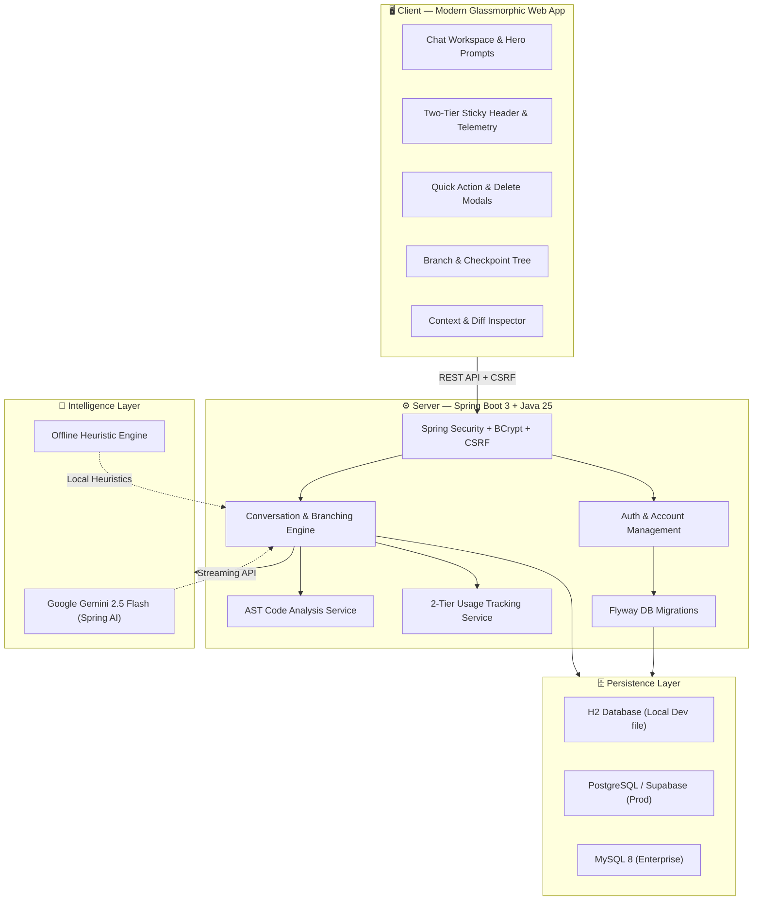

<div align="center">

# 🧭 CodeCompass

### Intelligent Developer Companion & AI-Powered Engineering Workspace

> *AST Code Intelligence + Conversation Branching + Spring Boot & Modern Glassmorphic UI*

<p align="center">
  
  
  
  
  
  
  
  
</p>

<p align="center">
  <a href="https://github.com/guptalalit9528/CodeCompass/stargazers"></a>
  <a href="https://github.com/guptalalit9528/CodeCompass/network/members"></a>
  <a href="https://github.com/guptalalit9528/CodeCompass/issues"></a>
  <a href="https://github.com/guptalalit9528/CodeCompass/graphs/contributors"></a>
</p>

</div>

<p align="center">
  An enterprise-grade developer assistance platform built with <strong>Java 25</strong>, <strong>Spring Boot</strong>, and a <strong>modern glassmorphic frontend</strong>.<br />
  Combines <strong>Google Gemini AI</strong> with <strong>Abstract Syntax Tree (AST) code analysis</strong>, <strong>conversation branching & checkpoints</strong>, <strong>project isolation</strong>, and <strong>real-time token telemetry</strong>.
</p>

> [!NOTE]
> **Zero-Dependency Offline Fallback** — CodeCompass operates seamlessly with or without an external Gemini API key. When unconfigured, it activates a built-in offline AST inspection and heuristics troubleshooting engine.

---

## 📑 Table of Contents

- [Why CodeCompass?](#-why-codecompass)
- [Key Features](#-key-features)
- [Architecture](#-architecture)
- [Tech Stack](#-tech-stack)
- [Getting Started](#-getting-started)
  - [Prerequisites](#prerequisites)
  - [🐳 Fast Setup with Docker](#-fast-setup-with-docker-recommended)
  - [💻 Manual Setup & Local Run](#-manual-setup--local-run)
    - [Windows (PowerShell)](#-windows-powershell)
    - [macOS / Linux](#-macos--linux)
- [Configuration](#-configuration)
  - [1. Gemini AI Configuration](#1--gemini-ai-configuration-optional)
  - [2. Email & SMTP Configuration](#2--email--smtp-configuration)
  - [3. Database Configuration](#3--database-configuration)
- [Project Structure](#-project-structure)
- [API Reference](#-api-reference)
- [Environment Variables](#-environment-variables)
- [Troubleshooting](#-troubleshooting)
- [Roadmap](#-roadmap)
- [Contributing](#-contributing)
- [Authors & Contributors](#-authors--contributors)

---

## 💡 Why CodeCompass?

Modern software engineering requires rapid debugging, architectural exploration, and context-heavy reasoning. Generic chatbots lose context, cannot track alternate solution paths, and lack code structure awareness:

| Challenge | CodeCompass Solution |
|---|---|
| Chatbots lose codebase context | **Pinned AST Context** — pin syntax summaries, diffs, and snippets into AI memory |
| Single-thread chats hit dead ends | **Conversation Branching** (`🌿 feature/auth`) & checkpoint history for non-linear exploration |
| API costs & token usage spiral unnoticed | **2-Tier Token Telemetry** — live session metrics (`0 ms · 5,056 tok · $0.0000`) + lifetime spend tracker |
| Cloud outages halt development | **Built-in Offline Engine** — heuristic code guidance even without an internet connection or API key |
| Juggling disconnected tools | **Unified Workspace** — code comparison, AST inspector, token meters, and project isolation in one UI |

---

## ✨ Key Features

### 🤖 Dual Intelligence Engine
- **Online Mode**: Integrates with **Google Gemini 2.5 Flash** via Spring AI for multi-turn reasoning, streaming assistance, and syntax-aware answers.
- **Offline Mode**: Automatically triggers when no API key is detected, providing structured diagnostic trees and debugging protocols.

### 🌿 Conversation Branching & Checkpoints
- Fork any conversation thread at any response into an independent branch (e.g., `🌿 refactor-auth`, `🌿 experiment-graphql`).
- Save immutable session checkpoints to review alternative algorithmic choices without losing your chat history.

### 🧩 AST Code Analysis & Diffs
- Built-in AST summarizer analyzes source code structures and generates semantic summaries.
- Compare multi-model code recommendations side-by-side with visual diff views.

### 🎨 Modern Glassmorphic UI & Mobile Layout
- Sleek dark/light theme toggle with sticky, two-tier navigation and backdrop blur.
- Quick-action modal popups (`Options & Quick Actions` and centered danger modals for project deletion).
- Responsive mobile toolbar (`< 640px`) with abbreviated session telemetry and title truncation.
- Keyboard power shortcuts: `⌘N` / `Ctrl+N` for instant new chats and `⌘Enter` / `Ctrl+Enter` to send prompts.

### 🔒 Enterprise Security & Isolation
- **Authentication**: BCrypt password hashing, session tokens, OTP email verification, and brute-force throttling (`LoginRateLimiter`).
- **Data Protection**: CSRF tokens on all mutation endpoints, per-user project isolation, and encrypted user API key vaults.

---

## 🏗 Architecture



---

## 🛠 Tech Stack

<table>
  <thead>
    <tr>
      <th>Layer</th>
      <th>Technology</th>
      <th>Purpose</th>
    </tr>
  </thead>
  <tbody>
    <tr>
      <td rowspan="4"><strong>Backend</strong></td>
      <td>Java 25</td>
      <td>Modern LTS Java runtime with virtual threads & performance features</td>
    </tr>
    <tr>
      <td>Spring Boot 3.4+</td>
      <td>Enterprise-grade microframework & REST controllers</td>
    </tr>
    <tr>
      <td>Spring AI (2.0+)</td>
      <td>Native Google Gemini model client and prompt engineering</td>
    </tr>
    <tr>
      <td>Spring Security 6+</td>
      <td>BCrypt encryption, session isolation, CSRF protection, and rate limiting</td>
    </tr>
    <tr>
      <td rowspan="4"><strong>Frontend</strong></td>
      <td>React 18 + TypeScript</td>
      <td>Modern reactive UI components and state management</td>
    </tr>
    <tr>
      <td>Tailwind CSS</td>
      <td>Utility-first glassmorphic styling, custom animations, and responsive breakpoints</td>
    </tr>
    <tr>
      <td>Lucide Icons</td>
      <td>Clean, unified iconography across cards, headers, and modal actions</td>
    </tr>
    <tr>
      <td>Local Storage Sync</td>
      <td>Persistent 2-tier token telemetry and theme preferences</td>
    </tr>
    <tr>
      <td rowspan="4"><strong>Persistence</strong></td>
      <td>H2 Database</td>
      <td>Zero-config file-based embedded SQL engine for instant local development</td>
    </tr>
    <tr>
      <td>PostgreSQL 14+</td>
      <td>Production relational storage (Supabase / Render ready)</td>
    </tr>
    <tr>
      <td>MySQL 8+</td>
      <td>Enterprise relational storage driver support</td>
    </tr>
    <tr>
      <td>Flyway</td>
      <td>Automated, version-controlled SQL database migrations (`V1` to `V4`)</td>
    </tr>
    <tr>
      <td rowspan="2"><strong>DevOps</strong></td>
      <td>Docker (Multi-Stage)</td>
      <td>Containerized packaging (`eclipse-temurin:25-jre-noble`)</td>
    </tr>
    <tr>
      <td>Maven 3.9+</td>
      <td>Build automation, dependency management, and test lifecycle</td>
    </tr>
  </tbody>
</table>

---

## 🚀 Getting Started

### Prerequisites

| Tool | Version | Verification | Download |
|---|---|---|---|
| JDK | 25+ | `java -version` | [Adoptium Temurin](https://adoptium.net) |
| Maven | 3.9+ | `mvn -version` | [maven.apache.org](https://maven.apache.org) |
| Docker *(Optional)* | 20+ | `docker --version` | [docker.com](https://www.docker.com) |
| Git | Any | `git --version` | [git-scm.com](https://git-scm.com) |

---

## 🐳 Fast Setup with Docker (Recommended)

Run CodeCompass in an isolated container without needing local Java or Maven installations:

### 1. Build and Run Container
```bash
docker build -t codecompass:latest .
docker run -p 10000:10000 -e PORT=10000 codecompass:latest
```

Open your browser and navigate to:
- **Web App**: [http://localhost:10000](http://localhost:10000)

---

## 💻 Manual Setup & Local Run

### 📥 Clone the Repository
```bash
git clone https://github.com/guptalalit9528/CodeCompass.git
cd CodeCompass
```

---

### 🪟 Windows (PowerShell)

1. **Verify or set JDK 25 in your PowerShell terminal:**
```powershell
$jdk = Get-ChildItem 'C:\Program Files\Eclipse Adoptium' -Directory -Filter 'jdk-25*' | Select-Object -First 1
if (-not $jdk) { throw 'JDK 25 was not found under C:\Program Files\Eclipse Adoptium' }
$env:JAVA_HOME = $jdk.FullName
$env:Path = "$env:JAVA_HOME\bin;$env:Path"
java -version
mvn -version
```

2. **If `mvn` is cached in your user profile:**
```powershell
$mvn = Get-ChildItem "$env:USERPROFILE\.m2\wrapper\dists" -Filter 'mvn.cmd' -Recurse | Select-Object -First 1 -ExpandProperty FullName
```

3. **Start the application:**
```powershell
mvn spring-boot:run
# Or using the cached Maven binary:
& $mvn spring-boot:run
```

---

### 🍎 macOS / 🐧 Linux

1. **Verify Java 25:**
```bash
java -version
mvn -version
```

2. **Package and run:**
```bash
mvn clean package -DskipTests
java -jar target/codecompass-1.0.0.jar
```

3. **Or run with Spring Boot plugin directly:**
```bash
mvn spring-boot:run
```

Open [http://localhost:8080](http://localhost:8080) in your browser.

---

## 🔐 Configuration

### 1. 🤖 Gemini AI Configuration (Optional)
Without an API key, CodeCompass uses its built-in offline troubleshooting guidance. To enable live Gemini AI answers:

**macOS / Linux:**
```bash
export GEMINI_API_KEY="your-gemini-api-key"
export GEMINI_MODEL="gemini-2.5-flash"
```

**Windows (PowerShell):**
```powershell
$env:GEMINI_API_KEY = 'your-gemini-api-key'
$env:GEMINI_MODEL = 'gemini-2.5-flash'
```

> Obtain a key from [Google AI Studio](https://aistudio.google.com/app/apikey). Never commit real API keys into git.

---

### 2. 📧 Email & SMTP Configuration
Email is used for account verification (OTP) and password resets:

```bash
# Environment Variables
export MAIL_HOST="smtp.gmail.com"
export MAIL_PORT="587"
export MAIL_USERNAME="your-address@gmail.com"
export MAIL_PASSWORD="your-gmail-app-password"
export MAIL_FROM="your-address@gmail.com"
export MAIL_SMTP_AUTH="true"
export MAIL_SMTP_STARTTLS="true"
export APP_BASE_URL="http://localhost:8080"
```

> **Development Mode:** `MAIL_DEV_FALLBACK=true` (default) prints OTP verification codes and reset links directly to the server terminal output if SMTP credentials are not configured.

---

### 3. 🗄 Database Configuration

#### 🔹 H2 Embedded File (Default)
Stores data in `./data/codecompass.mv.db`. Zero setup required. The directory is automatically created and git-ignored.

#### 🔹 PostgreSQL / Supabase
Activate the PostgreSQL Supabase profile:

```bash
export SPRING_PROFILES_ACTIVE="supabase"
export SUPABASE_DB_URL="jdbc:postgresql://<host>:5432/<dbname>"
export SUPABASE_DB_USERNAME="postgres"
export SUPABASE_DB_PASSWORD="your-db-password"
```

#### 🔹 MySQL 8+
```bash
export DB_URL="jdbc:mysql://localhost:3306/codecompass"
export DB_USERNAME="your-user"
export DB_PASSWORD="your-password"
```

> **Flyway Migrations:** All tables and schema updates (`V1__initial_schema.sql` through `V4__increase_message_content_length.sql`) execute automatically upon application boot.

---

## 📁 Project Structure

```
CodeCompass/
│
├── src/main/java/dev/codecompass/
│   ├── CodeCompassApplication.java       # Application entry point & profile bootstrapper
│   ├── SecurityConfiguration.java        # Spring Security, CSRF, and CORS policies
│   ├── WebMvcConfig.java                 # Static resource routing
│   │
│   ├── AuthController.java               # Authentication endpoints (/api/auth/*)
│   ├── AuthService.java                  # User registration, OTP verification, sessions
│   ├── LoginRateLimiter.java             # IP-based rate limiting & brute-force defense
│   ├── MailDeliveryService.java          # SMTP email delivery & dev console fallback
│   │
│   ├── ChatController.java               # Chat messaging endpoints (/api/chat/*)
│   ├── ConversationService.java          # Multi-turn conversation persistence & history
│   ├── ConversationController.java       # Conversation management endpoints
│   ├── AdvancedWorkspaceController.java  # Branching, checkpoints, and AST diff endpoints
│   ├── AdvancedWorkspaceService.java     # AST parsing, checkpoints, and context logic
│   ├── CodeAnalysisService.java          # Source code structure analysis
│   │
│   ├── GeminiAssistantService.java       # Google Gemini 2.5 Flash model integration
│   ├── GeminiApiKeyCondition.java        # Dynamic fallback when AI key is missing
│   ├── GeminiChatModelConfiguration.java # Spring AI Gemini chat model bean
│   │
│   ├── ProjectController.java            # Project isolation endpoints (/api/projects/*)
│   ├── ProjectService.java               # Project hierarchy and collaborator access
│   ├── SettingsController.java           # User preferences and API keys
│   └── UsageTrackingService.java         # Token telemetry & spending ledger
│
├── src/main/resources/
│   ├── application.properties            # Core Spring configuration & H2/MySQL profiles
│   ├── application-supabase.properties   # PostgreSQL & Supabase profile configuration
│   ├── db/migration/                     # Flyway SQL schema migrations
│   │   ├── V1__initial_schema.sql
│   │   ├── V2__settings_api_keys_usage.sql
│   │   ├── V3__advanced_workspace_features.sql
│   │   └── V4__increase_message_content_length.sql
│   └── static/                           # Modern React Frontend Single-Page App
│       ├── index.html                    # Glassmorphic developer workspace & UI
│       └── components/                   # Modular React components
│           ├── TopHeader.tsx             # Two-tier sticky header & live telemetry
│           ├── NewChatButton.tsx         # Full-width sidebar action with ⌘N badge
│           ├── DeleteProjectModal.tsx    # Glassmorphic danger confirmation modal
│           └── index.ts                  # Component barrel export
│
├── src/test/java/dev/codecompass/        # Comprehensive unit & integration tests
├── Dockerfile                            # Multi-stage production container build
├── pom.xml                               # Maven project object model
└── README.md                             # Project documentation
```

---

## 📡 API Reference

| Method | Endpoint | Description |
|---|---|---|
| `POST` | `/api/auth/register` | Register new developer account |
| `POST` | `/api/auth/verify-otp` | Verify 6-digit email OTP |
| `POST` | `/api/auth/login` | Authenticate and create session |
| `POST` | `/api/auth/logout` | Invalidate active session |
| `GET` | `/api/projects` | List all scoped projects |
| `POST` | `/api/projects` | Create a new project container |
| `DELETE` | `/api/projects/{id}` | Permanently delete project and sub-chats |
| `GET` | `/api/conversations` | Retrieve conversation threads |
| `POST` | `/api/chat` | Send prompt to AI / fallback engine |
| `GET` | `/api/chat/{id}` | Retrieve chat message history |
| `POST` | `/api/conversations/{id}/branches` | Create a new conversation branch |
| `POST` | `/api/conversations/{id}/checkpoints` | Save an immutable timeline checkpoint |
| `POST` | `/api/analysis/ast` | Request AST summary for code snippet |
| `GET` | `/api/settings/usage` | Fetch persistent token usage & spend stats |

### Example Request: Send Chat Message

```bash
curl -X POST http://localhost:8080/api/chat \
  -H "Content-Type: application/json" \
  -H "X-CSRF-TOKEN: <your-csrf-token>" \
  -d '{
    "conversationId": "c4b3a1-...",
    "message": "Explain how virtual threads improve Spring Boot throughput in Java 25."
  }'
```

---

## 🔑 Environment Variables

| Variable | Default | Description |
|---|---|---|
| `PORT` | `8080` | Port for the web server to listen on |
| `GEMINI_API_KEY` | *None* | Google Gemini API key (triggers offline mode if unset) |
| `GEMINI_MODEL` | `gemini-2.5-flash` | Gemini model variant to invoke |
| `SPRING_PROFILES_ACTIVE` | *None* | Set to `supabase` to activate PostgreSQL profile |
| `SUPABASE_DB_URL` | *None* | JDBC PostgreSQL connection URL |
| `SUPABASE_DB_USERNAME` | *None* | PostgreSQL username |
| `SUPABASE_DB_PASSWORD` | *None* | PostgreSQL password |
| `MAIL_HOST` | `smtp.gmail.com` | SMTP host for email dispatch |
| `MAIL_PORT` | `587` | SMTP port |
| `MAIL_USERNAME` | *None* | SMTP authentication email username |
| `MAIL_PASSWORD` | *None* | SMTP authentication password / App password |
| `MAIL_DEV_FALLBACK` | `true` | When `true`, prints OTP tokens to the server console |
| `APP_BASE_URL` | `http://localhost:8080` | Base URL used in email reset links |

---

## ❓ Troubleshooting

<details>
<summary><strong>"UnsupportedClassVersionError: class file version 69.0"</strong></summary>

- CodeCompass is built with **Java 25**.
- Ensure `JAVA_HOME` points to JDK 25 and check `java -version`.
- On Windows, verify Eclipse Adoptium Temurin 25 is installed.
</details>

<details>
<summary><strong>"Port 8080 is already in use"</strong></summary>

- Terminate the conflicting process:
  - macOS/Linux: `lsof -ti :8080 | xargs kill -9`
  - Windows: `netstat -ano | findstr :8080` then `taskkill /PID <PID> /F`
- Or launch on a different port:
  - `java -Dserver.port=8090 -jar target/codecompass-1.0.0.jar`
</details>

<details>
<summary><strong>"AI answers state offline fallback is active"</strong></summary>

- Verify `GEMINI_API_KEY` is exported in the same terminal session before starting the application.
- Test key validity in Google AI Studio.
</details>

<details>
<summary><strong>"Email verification code not arriving"</strong></summary>

- By default, `MAIL_DEV_FALLBACK=true` prints the 6-digit OTP code directly to your terminal standard output.
- Check the console logs for: `[DEV EMAIL FALLBACK] Verification code: 123456`.
- For real SMTP delivery, verify you have generated a Gmail App Password (not your normal Google account password).
</details>

---

## 🗺 Roadmap

- [x] 🤖 Google Gemini 2.5 Flash integration via Spring AI
- [x] 🌿 Conversation branching & immutable checkpoint trees
- [x] 🎨 Modern glassmorphic React interface with dark/light mode
- [x] 📱 Fully responsive mobile layout (`< 640px`) with compact meters
- [x] ⏱️ 2-Tier persistent token telemetry and spend tracker
- [x] 🐳 Multi-stage production Docker packaging
- [ ] 🔍 Semantic vector embeddings & Retrieval-Augmented Generation (RAG)
- [ ] 🐙 GitHub PR review bot & Git hook integration
- [ ] 🎙️ Voice prompt dictation & speech synthesis

---

## 🤝 Contributing

Contributions make open-source projects thrive! Whether it's a bug fix, feature addition, or UI polish:

1. **Fork the Repository**
2. **Create a Feature Branch**
   ```bash
   git checkout -b feat/amazing-feature
   ```
3. **Commit your Changes**
   ```bash
   git commit -m "feat: add amazing feature"
   ```
4. **Push to the Branch**
   ```bash
   git push origin feat/amazing-feature
   ```
5. **Open a Pull Request**

---

## 👥 Authors & Contributors

<a href="https://github.com/guptalalit9528/CodeCompass/graphs/contributors">
  
</a>

### 👤 Author
- **Lalit Gupta** ([@guptalalit9528](https://github.com/guptalalit9528))
  - GitHub: [https://github.com/guptalalit9528](https://github.com/guptalalit9528)
  - Repository: [https://github.com/guptalalit9528/CodeCompass](https://github.com/guptalalit9528/CodeCompass)

### 🌟 Contributors
- **Gopal Gupta** ([@gopaljilab](https://github.com/gopaljilab))
  - GitHub: [https://github.com/gopaljilab](https://github.com/gopaljilab)

---

<div align="center">

*Built with ❤️ for modern software engineering teams*

⭐ **Star this repository** if you find CodeCompass helpful!

</div>
